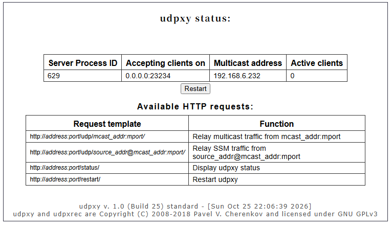

# 老毛子（Padavan）固件 IPTV 配置教程

> 测试环境：小米路由器 mini（RT-AC54U-GPIO-30-xiaomimini-128M），Padavan 固件 3.4.3.9-099_26-03-1，2026-10-25

在上游 IPTV 组播已经可用的前提下，按本文配置后，局域网里的电脑、手机、电视盒子可以通过 `http://192.168.123.1:23234/udp/组播地址:端口` 观看运营商的 IPTV 直播，也可以通过 Wi-Fi 接入观看。

## 一、原理与准备

关于运营商 IPTV 的 UDP/RTP 组播传输，以及 udpxy 将其转换为 HTTP 单播的基本思路，可以先阅读之前的微信公众号文章 [《在安卓机顶盒中看宽带运营商 IPTV》](https://mp.weixin.qq.com/s/2BK9NeseH6v-BfGyUl9bGQ)。本文主要介绍 Padavan 固件上的配置步骤。

本文使用的运营商 IPTV 直播通过**组播（Multicast）**传输。udpxy 从上游接口接收组播，再转换成 HTTP 单播，供局域网设备上的播放器读取。播放器仍需支持频道使用的媒体格式和音视频编码。

如果希望内网设备直接订阅原始组播，则需要 igmpproxy 处理上下游的组成员关系，并将组播流转发到内网。它与 udpxy 承担不同的工作；udpxy 直接从 WAN 接收组播时，通常不需要先由 igmpproxy 把流量转进 LAN。

组播进入内网后，可以通过 IGMP 侦听限制它的转发范围，减少无关端口收到的流量；无线侧的 M2U 则把组播转换成发给接收设备的单播。如果设备通过 udpxy 的 HTTP 地址播放，无线侧传输的已经是单播，播放质量主要取决于无线链路和路由器的处理能力。

开始配置前，需要确认路由器 WAN 口能够收到 IPTV 组播。本例中 mini 的 WAN 口接在光猫（或上级路由）的 LAN 口下，通过 DHCP 获取 `192.168.6.x` 地址，上游已经放通了组播。能获取地址本身并不代表组播可用，普通上网 LAN 口也不一定提供 IPTV；如果当地业务需要 IPTV 专口、VLAN 或认证，应先完成相应接入配置。

接下来需要准备一份本地区、对应运营商的 IPTV 频道列表，从中取得实际的组播地址和端口。频道列表可以从公开的本地区资料中查找，也可以通过光猫侧抓包获取。用于验证的播放器，电脑上可以选择 VLC 或 PotPlayer，电视或盒子上可以使用支持相应直播源的 TVBox、DIYP、Kodi 等。

本文中的 `192.168.123.1` 是 Padavan 路由器的 LAN 地址，使用时请替换成自己路由器的实际地址。

## 二、IPTV 设置（核心）

进入 **高级设置 → 内部网络 (LAN) → IPTV**，本例的设置如下图所示。


在页面上方，本例打开了“启用组播路由到内网”，由 igmpproxy 提供 WAN 到 LAN 的组播转发。“实现快速频道切换”选择“是”，启用 IGMP quickleave；如果多台设备直接订阅组播，出现一台换台影响另一台播放的情况，可以尝试关闭这个选项。“强制 IGMP 协议版本”先保持“否”，让系统自动处理。

在“IPTV 代理服务器”区域，将“UDP 代理 (Udpxy)”填写为 `23234`，这是播放器访问 HTTP 服务时使用的端口，填 `0` 则会关闭 udpxy。本例不使用 xUPNPd，因此将它的 Web 端口保留为 `0`。

在下方的组播流量设置中，打开“启用 IGMP/MLD 侦听”，将“M2U - 以太网交换机”设为“HW IGMP/MLD snooping”，让有线交换机按订阅关系转发组播。无线 2.4GHz 和 5GHz 的 M2U 均选择“Multicast to Unicast”，用于改善直接在无线网络上传输组播的情况。设置完成后，点击“应用本页面设置”。

应用后，可以通过 SSH 确认两个服务都已运行：

```sh
ps | grep -E "udpxy|igmpproxy"
# /usr/sbin/udpxy -m eth2.2 -p 23234 -B 65536 -c 10 -M
# /bin/igmpproxy /etc/igmpproxy.conf
```

这里的 `eth2.2` 是本机 udpxy 使用的组播接收接口，其他机型或接线方式下的接口名称可能不同。

## 三、验证 udpxy

浏览器打开 `http://192.168.123.1:23234/status`，能看到 udpxy 状态页，说明 HTTP 服务已经可以访问。下图中，组播来源接口的地址是 WAN 口的 `192.168.6.232`，当前活跃客户端数为 `0`，此时还不能据此判断频道流是否能够正常接收。



## 四、客户端播放

播放地址格式：

```
http://192.168.123.1:23234/udp/组播地址:端口
```

例如组播地址是 `239.3.1.1:8000`，播放地址就是 `http://192.168.123.1:23234/udp/239.3.1.1:8000`。

在 VLC 或 PotPlayer 中，通过“打开网络串流”或相应的网络地址入口，粘贴上面的地址即可尝试播放。打开一个已知有效的频道后，可以刷新 udpxy 状态页查看客户端连接，并确认画面和声音能够持续播放。

如果需要在电视盒子上导入多个频道，可以将各频道地址改成上面的格式，保存为 `iptv.m3u`，再导入播放器。文件内容可以参考下面的示例：

```
#EXTM3U
#EXTINF:-1,CCTV-1
http://192.168.123.1:23234/udp/239.3.1.1:8000
#EXTINF:-1,CCTV-2
http://192.168.123.1:23234/udp/239.3.1.2:8000
```

（上面的组播地址只是示例，请换成你所在地区运营商的实际地址。）

## 五、常见问题

如果打不开状态页，先确认访问的是路由器实际的 LAN 地址，udpxy 端口没有设为 `0`，并且进程已经运行，再检查客户端到路由器的连通性和防火墙策略。截图中的服务监听在 `0.0.0.0:23234`，并非只绑定 LAN 地址，哪些网络能够访问仍取决于防火墙设置。

如果状态页能够打开，但播放器始终没有画面，应先核对频道的组播地址、端口和封装格式，再确认 udpxy 使用的接收接口是否正确、光猫或上级路由是否提供了相应组播，以及防火墙是否允许接收。HTTP 服务正常不等于组播已经到达；播放器的音视频解码能力也会影响最终能否出画面。

如果频道播放几秒后就断流，需要结合上游 IGMP 查询、成员关系维护和网络丢包情况排查，不能仅凭断流时间认定是查询超时。如果确认与上游 IGMP 版本兼容性有关，可以尝试将“强制 IGMP 协议版本”改为 IGMPv2，再观察播放是否恢复稳定。

如果通过 HTTP 地址观看时只有 Wi-Fi 下卡顿，可以先改用有线连接对比，并检查无线信号、实际吞吐、频道码率和路由器 CPU 占用。对于直接订阅原始组播的设备，再检查 IGMP 侦听和无线 M2U 设置是否合适。

多台设备同时观看时，还要留意 udpxy 的并发限制。本文进程示例中的 `-c 10` 表示最多允许 10 个客户端连接，并不代表这台路由器一定能稳定承载 10 路高清播放。HTTP 出站带宽会随观看连接增加，实际承载能力还取决于频道码率、路由器性能和网络状况。

如果希望在外网观看，建议先通过 VPN 接入家庭网络，再访问 udpxy。本例的 WAN 地址属于 `192.168.6.x` 私网，仅在 Padavan 上放行 `23234` 端口并不足以实现公网访问，还涉及上级路由、NAT 和公网可达性；直接对外开放时也需要额外的访问控制。
